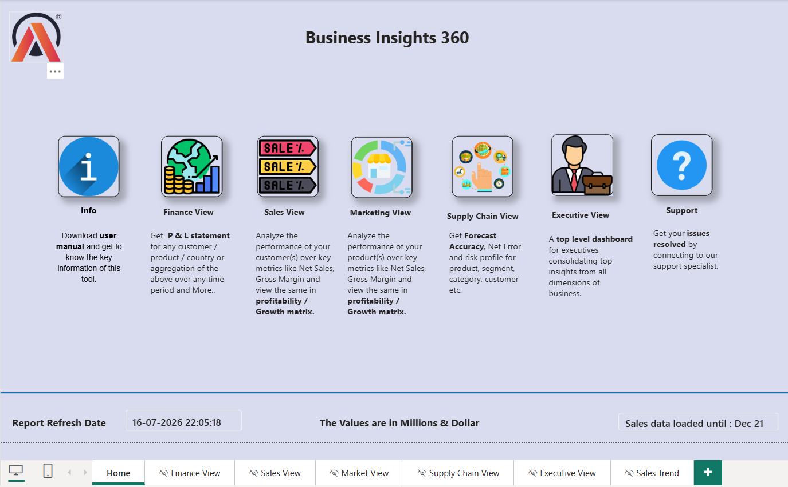
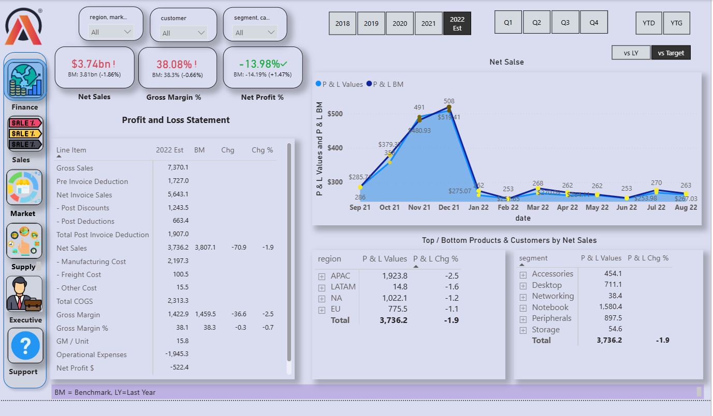
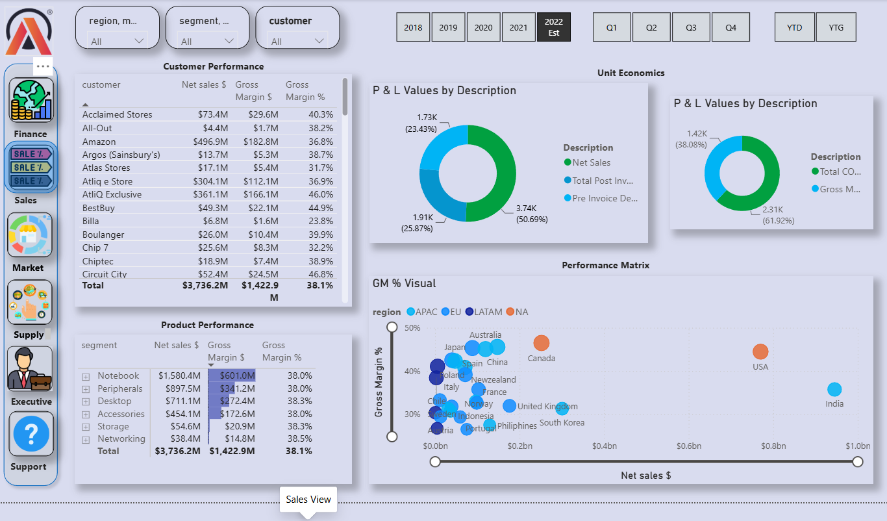
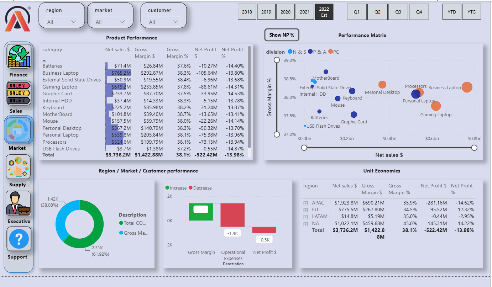
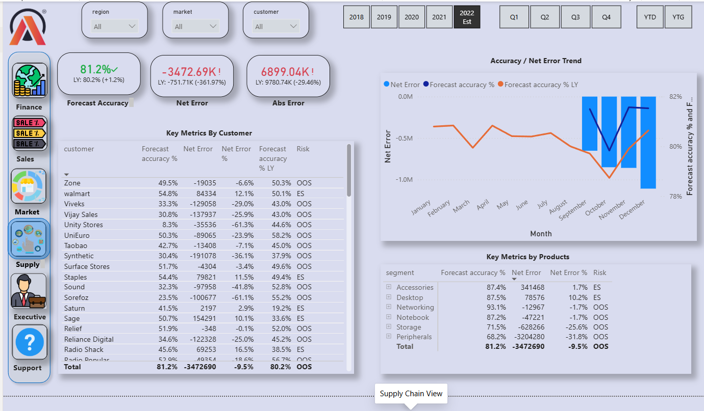
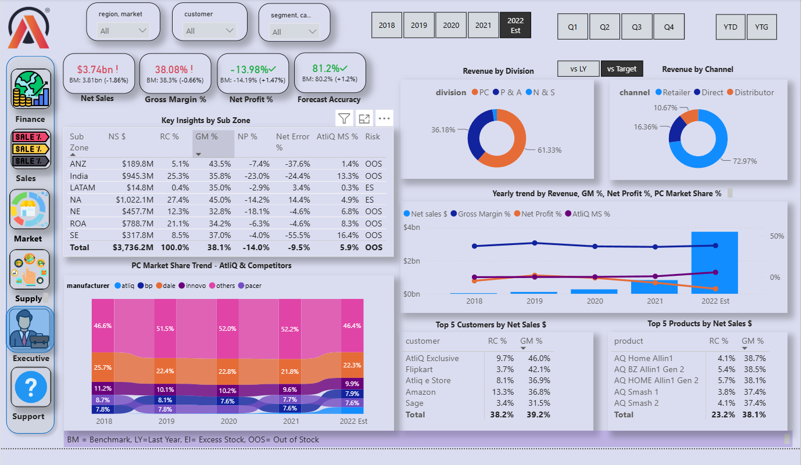

# Business Insights 360 — Power BI Business Performance Analysis

> An interactive business intelligence dashboard designed to help leaders understand financial performance, sales, market performance, supply-chain forecasting, and overall business health.

## Project at a glance

**Tool:** Power BI  
**Analysis areas:** Finance, Sales, Market, Supply Chain, Executive reporting  
**Primary goal:** Turn business metrics into clear questions, practical findings, and actions that can improve profitability, sales effectiveness, inventory availability, and decision-making.

This repository documents the dashboard screenshots and explains the business questions a Data Analyst can answer with them. The figures shown in the screenshots appear to use an **estimated 2022 view** and values are labelled in **millions of dollars**. Treat these as dashboard-reported figures, not verified current company results.

## Dashboard pages

### 1. Home — Business Insights 360

The landing page links to Finance, Sales, Market, Supply Chain, Executive, and Support views. It also displays the report refresh date and the period through which sales data has been loaded.

**Questions this page helps answer**
- Which business function should a stakeholder investigate first?
- How recently was the report refreshed?
- Up to what date is sales data available?
- Which teams need a deeper drill-down into the business results?

**Analyst interpretation**
The home page is useful as a navigation and data-freshness checkpoint. Before sharing conclusions, confirm that the refresh completed successfully and that the loaded period covers the reporting window.

### 2. Finance View — Profitability and P&L

The Finance page includes Net Sales, Gross Margin %, Net Profit %, a Profit & Loss statement, a monthly net-sales trend, and regional and segment summaries.

**Questions and answers from the visible dashboard**

**Q: Is the business meeting its sales benchmark?**  
**A:** The KPI shows net sales of approximately **$3.74bn**, compared with a benchmark of **$3.81bn** — around **1.86% below benchmark**. This suggests a sales shortfall that deserves investigation by region, customer, product, and channel.

**Q: Is revenue translating into profit?**  
**A:** Gross margin is shown at about **38.08%**, slightly below the **38.3% benchmark**. Net profit is shown at approximately **-13.98%**, while the benchmark is about **-14.19%**. The net-profit percentage is therefore slightly better than the benchmark, but it remains negative. The business should focus on the drivers of operating costs and product/customer profitability rather than looking at revenue alone.

**Q: What happened to sales around the end of 2021?**  
**A:** The monthly trend rises sharply through late 2021, peaking around December, and then drops substantially in January 2022. This could reflect seasonality, a change in reporting coverage, or a genuine sales decline. Compare the same months across years and validate the data before calling it a trend.

**Q: Which regions contribute most to sales?**  
**A:** APAC is the largest region in the displayed summary at roughly **$1.924bn**, followed by North America at around **$1.022bn**. EU contributes around **$775.5m**, while LATAM is much smaller at about **$14.8m**. Check whether the small LATAM figure reflects the actual business, missing data, or a filter/model issue.

**Recommended actions**
- Break the sales gap down by product, customer, region, and channel.
- Identify products with high sales but weak or negative net profit.
- Review manufacturing, freight, discounts, and other deductions to see which costs are rising fastest.
- Compare monthly results with the same month in the prior year to separate seasonality from underperformance.

### 3. Sales View — Customer, Product, and Market Performance

The Sales page shows customer and product performance, net sales, gross margin, and a performance matrix comparing sales with gross margin.

**Questions and answers from the visible dashboard**

**Q: Which product segments generate the most sales?**  
**A:** Notebooks are the largest displayed segment at about **$1,580.4m** in net sales, followed by Peripherals at about **$897.5m**, Desktop at **$711.1m**, Accessories at **$454.1m**, Storage at **$54.6m**, and Networking at **$38.4m**.

**Q: Are the highest-selling products also the most profitable?**  
**A:** Not necessarily. The displayed gross-margin percentages across segments are clustered around **38%**, but this does not show net profit by itself. To decide where to invest, compare gross margin with operating costs, returns, discounts, and support costs at product level.

**Q: Which customers have significant sales?**  
**A:** In the visible customer table, **Amazon** shows around **$496.9m** in net sales, while **Atliq Exclusive** shows around **$361.1m**. These are examples of large accounts to monitor for retention, concentration risk, margin, and growth opportunities.

**Q: Which markets appear to combine high sales and healthy gross margin?**  
**A:** The performance matrix places countries such as India and the USA at relatively high sales levels in the displayed view. Their margin positions differ, so sales volume alone should not determine priority. Compare net profit, growth, market size, and strategic costs before deciding where to expand.

**Recommended actions**
- Build a product/customer profitability ranking, not just a revenue ranking.
- Review the largest accounts for retention risks and account-specific discounts.
- Identify high-margin products with low sales and test whether better placement, bundling, or campaigns could grow them.
- Investigate high-sales/low-margin markets before increasing spend.

### 4. Market View — Division, Channel, and Market Share

The Market page combines product performance, net profit, division and channel revenue, yearly trends, market-share trends, and top customers/products.

**Questions and answers from the visible dashboard**

**Q: Which divisions contribute most to revenue?**  
**A:** The displayed division chart assigns roughly **61.33%** to PC and about **36.18%** to P&A, with a small remaining share for N&S. Confirm the chart's exact mapping and totals in the underlying model before using the percentages in a formal report.

**Q: Which sales channel contributes the most?**  
**A:** Retailer is the largest visible channel at about **72.97%**, followed by Direct at **16.36%** and Distributor at **10.67%**. The business may be highly dependent on retailers, so channel concentration and retailer performance deserve attention.

**Q: How is the business trending over time?**  
**A:** The chart shows net sales increasing considerably in the 2022 estimate, while net profit percentage appears to deteriorate. This combination suggests that growth may not be translating into stronger profitability. Check cost, discount, product-mix, and one-off effects before drawing a firm conclusion.

**Q: How should market share be interpreted?**  
**A:** The market-share trend chart compares AtliQ with competitors over time. The visible shares vary by manufacturer and year. A useful next step is to compare share movement with revenue growth, pricing, and gross margin to understand whether share gains are profitable.

**Recommended actions**
- Reduce over-reliance on a single channel by evaluating direct and distributor growth opportunities.
- Compare revenue growth with net profit and gross-margin trends.
- Track market share alongside pricing, campaign spend, and competitor activity.
- Identify the top customer and product combinations driving revenue, then check their margins and retention risks.

### 5. Supply Chain View — Forecast Accuracy and Stock Risk

The Supply Chain page includes forecast accuracy, net error, absolute error, monthly trends, customer/product-level metrics, and risk labels such as OOS and ES.

**Questions and answers from the visible dashboard**

**Q: How accurate is the forecast overall?**  
**A:** The headline forecast accuracy is approximately **81.2%**, compared with **80.2% last year** — an improvement of about **1 percentage point**.

**Q: Is forecast error still a concern?**  
**A:** The headline net error is around **-3.47m** and the net error percentage is around **-9.5%** in the summary table. The sign convention matters: confirm whether negative error means under-forecasting or over-forecasting in this model before recommending inventory changes.

**Q: Which product groups may need attention?**  
**A:** The displayed table shows Accessories at about **87.4%** forecast accuracy, Desktop at **87.5%**, and Networking at **93.1%**. Storage is around **71.5%** and Peripherals around **68.2%**, making these two groups priority candidates for forecast-error investigation.

**Q: What do OOS and ES mean?**  
**A:** The dashboard footer defines **OOS as Out of Stock** and **ES as Excess Stock**. These labels help distinguish products or customers at risk of lost sales from those at risk of carrying too much inventory.

**Recommended actions**
- Prioritise forecast root-cause analysis for Storage and Peripherals.
- Compare forecast error by product, customer, month, and region to spot recurring patterns.
- Check whether promotions, seasonality, supplier lead times, or stockouts explain forecast misses.
- Use both forecast accuracy and stock-risk measures; a better accuracy score does not automatically guarantee the right inventory position.

### 6. Executive View — A Consolidated Business Story

The Executive page combines high-level KPIs, sub-zone performance, division/channel revenue, multi-year trends, market share, and top customers and products.

**Questions and answers from the visible dashboard**

**Q: What is the overall business story?**  
**A:** In this dashboard snapshot, net sales are around **$3.74bn**, below the benchmark of **$3.81bn**. Gross margin is slightly below benchmark, and net profit percentage remains negative. Forecast accuracy is around **81.2%**, slightly above last year. The combined message is: sales are substantial, but the business needs to investigate margin pressure, profitability, and forecast weaknesses.

**Q: Which sub-zones need a closer look?**  
**A:** The sub-zone table marks several areas as OOS and shows variation in gross margin, net profit, net error, and market-share metrics. India is a large sales contributor in the displayed table, but its net-profit percentage is negative. Prioritise high-revenue areas with weak profitability, while checking the meaning and calculation of each metric.

**Q: What should leadership prioritise first?**  
**A:** Start with three workstreams: (1) understand the gap to sales benchmark, (2) isolate the biggest drivers of negative net profit, and (3) improve forecasts for product groups with lower accuracy. Assign an owner, a measurable target, and a review date to each workstream.

## Cross-functional business questions to investigate

| Business question | What to analyse | Possible action |
|---|---|---|
| Why are sales below benchmark? | Sales variance by product, customer, region, channel, and month | Create a ranked variance report and assign owners to the largest gaps |
| Why is net profit negative? | Discounts, COGS, freight, operating expenses, product mix, customer profitability | Review cost drivers and unprofitable products/accounts |
| Are we too dependent on a few customers or channels? | Revenue concentration and trend by customer/channel | Develop a diversification plan and monitor concentration |
| Which products should receive more investment? | Sales growth, gross margin, net profit, market share, inventory risk | Prioritise products with sustainable profit and growth potential |
| Where are we losing sales due to stockouts? | OOS status, demand, inventory, forecast error, supplier lead time | Improve replenishment and safety-stock rules |
| Where are we carrying excess stock? | ES status, ageing inventory, forecast bias, sell-through | Adjust purchasing and run targeted inventory-clearance actions |
| Is forecast accuracy improving for the right reasons? | Accuracy, signed error, absolute error by product/month/customer | Monitor both bias and error size; review root causes monthly |
| Which markets are growing profitably? | Market sales, growth, gross margin, net profit, competitor share | Invest selectively where growth and profit are both healthy |
| Are promotions creating profitable growth? | Before/after sales, discount rate, gross margin, repeat purchases | Keep promotions that generate incremental profit, not just volume |
| Are reporting figures reliable? | Refresh timestamp, data coverage, missing values, outliers, filter context | Add data-quality checks and a clear reporting-period note |

## Suggested analysis plan

1. **Validate the data:** confirm currency, units, period, definitions, filter selections, and refresh status.
2. **Find the largest variances:** compare actuals with benchmark/last year and rank the biggest positive and negative contributors.
3. **Move from revenue to profit:** calculate profitability by product, customer, region, and channel.
4. **Investigate supply risk:** connect forecast errors with stockouts, excess stock, lead times, and demand spikes.
5. **Recommend actions:** for every insight, state the evidence, likely cause, proposed action, owner, and KPI to monitor.
6. **Measure the result:** track the KPI after the action and compare it with a baseline.

## Important interpretation notes

- These answers are based only on what is visible in the supplied dashboard screenshots. They are **initial observations**, not proof of root cause.
- Some figures appear to be estimates for 2022. Confirm the reporting period and whether the dashboard is showing actuals, estimates, or a mixture.
- Confirm definitions for benchmark, net error, forecast accuracy, gross margin, net profit, and the division labels in the underlying model.
- The values are labelled in millions of dollars in the dashboard footer. Some visuals abbreviate values differently (for example, `$3.74bn`); verify unit formatting before publishing.
- Use the report's filters consistently when comparing numbers. Different filter selections can change the result.

## How to use this repository on GitHub

1. Create a new GitHub repository, for example `business-insights-360-power-bi`.
2. Upload `README.md` and the `screenshots/` folder.
3. Check that all screenshots render in the README preview.
4. If you have permission to share the original `.pbix` file and source data, add them in a separate folder or link to a secure source. Do not upload confidential business data.
5. Add a short project summary to your resume, for example:

> Built a Power BI Business Insights 360 dashboard to analyse finance, sales, market share, and supply-chain performance. Evaluated sales against benchmarks, compared product and customer profitability, identified forecast-accuracy gaps, and translated dashboard metrics into actionable business recommendations.

## Skills demonstrated

- Business performance analysis
- KPI interpretation and variance analysis
- Profit & Loss analysis
- Customer, product, region, and channel analysis
- Forecast accuracy and inventory-risk analysis
- Data storytelling and stakeholder communication
- Power BI dashboard interpretation

---
**Note:** This repository documents dashboard analysis and recommendations. It does not include the underlying dataset or the editable Power BI report.
